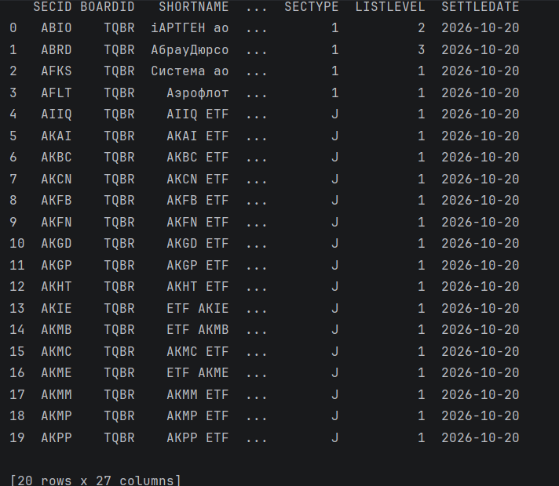

# Получение данных с Московской биржи

Скрипт по [API](https://iss.moex.com/iss/engines/stock/markets/shares/boards/TQBR/securities.json) получает данные с Московской биржи ISS

## Для запуска скрипта выполните 

```text
uv run python scripts/read_api.py
```

## первые 20 строк полученного датасета

